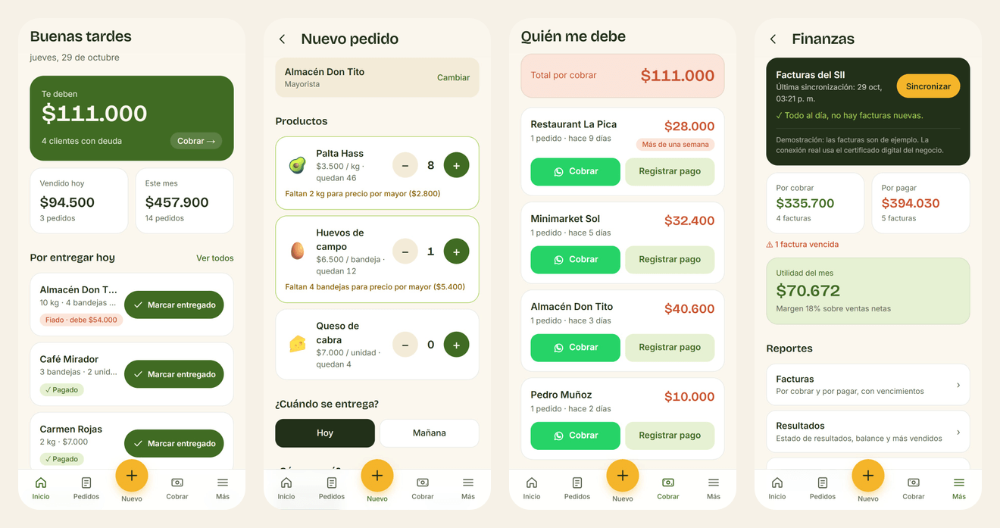

## Hi, I'm Consuelo 👋

**UX/UI Designer & Front-end Developer** based in Chile, open to remote roles with European teams.

I come from graphic design. Today I research users, design clear and accessible interfaces, and build them as working web apps with React, Next.js and Supabase.

### Featured

**[Fresco](https://github.com/cherreradlc/fresco)**: a mobile-first sales, payments and finance app for a small food business. Orders, debts, stock, an income statement, a sales projection and ledgers for the accountant. [Live demo →](https://fresco-demo-five.vercel.app)

**[Portfolio](https://github.com/cherreradlc/portfolio-2026)**: my site, with case studies built from typed data, a bilingual UI and real code excerpts. [consueloherreradesign.vercel.app →](https://consueloherreradesign.vercel.app)

I've also designed and built wedding invitation web apps for real couples, with RSVP flows, private guest lists and a dashboard for the couple. The code is private to protect their data, and the case studies are in my portfolio.

### Toolkit

- **Code:** React · Next.js · TypeScript · Tailwind CSS · Supabase (PostgreSQL) · MySQL · Git · Vercel
- **Design:** Figma · Illustrator · Photoshop · InDesign · UX research · prototyping · usability testing

### Contact

[Portfolio](https://consueloherreradesign.vercel.app) · [LinkedIn](https://www.linkedin.com/in/consueloherreradesign/) · contact.consudesign@gmail.com
